# Linguagem R

# 

<center>

</center>

::: footer
[r-project](https://www.r-project.org/)
:::

## Conteúdo {.smaller}

### Linguagem R

::::::: columns
:::: {.column width="50%"}
::: nonincremental
-  Linguagem R
-  RStudio
-  Console
-  Scripts
-  Operadores
-  Objetos
-  Funções
-  Pacotes
-  Ajuda
-  Ambiente
-  Citações
-  Principais erros
:::
::::

:::: {.column width="50%"}
::: nonincremental
-  Atributos dos objetos
-  Manejo de dados unidimensionais
-  Manejo de dados multidimensionais
-  Valores faltantes e especiais
-  Diretório de trabalho
-  Importar dados
-  Conferência de dados importados
-  Exportar dados
:::
::::
:::::::

# Mas por que aprender a linguagem R? Inglês não basta?!

# Minha história com o R

## Aprendizado {.smaller}

**Início**

-   2011: Curso de 40 horas com o Prof. Tadeu Siqueira

**Aprofundamento**

- 2012-2013: Estudei R sozinho por muito tempo...
- 2013-2015: Iniciação científica com SDM e Ecologia da Paisagem (Fapesp)
- 2015-2016: Assistente de Pesquisa no LEEC (Prof. Miltinho)
- 2016-2018: Mestrado em SDM
- 2020-2024: Doutorado em métricas de paisagem
- 2025-2027: Pós-Doutorado em ecologia espacial

## Ensino {.smaller}

- 2015: Minicurso de R na SEE
- 2016: Minicurso de R na SEE
- 2019: Minicurso de R na SEE
- 2019: Minicurso de R na SEBio
- 2019: Curso de SDM no R na Congresso Brasileiro de Herpetologia
- 2021: Curso de SDM no R no Mastozóologos Organizados em uma Conferência Online
- 2021: Minicurso de R na SEE
- 2022: Minicurso de R na SEE
- 2024: Minicurso de padrões espaciais da biodiversidade no R na São Paulo School of Advanced Science (SPSAS)
- 2024: Minicurso métricas de paisagem no R no Simpósio Brasileirao de Síntese Ecológica
Maria (UFSM)

## Disciplinas {.smaller}

- 2015: Ecologia Quantitativa (Unesp) (Monitor voluntário)
- 2016-2017: Modelagem de Nicho Ecológico: teoria e prática (Unesp e Unicamp)
- 2017: Ecologia Quantitativa (Unesp) (Estágio docência)
- 2018: Modelos Estatísticos em Ecologia (Unesp)
- 2019: Geoprocessamento para Etnobiologia e Conservação da Biodiversidade (UFRPE)
- 2020: Modelos Estatísticos em Ecologia (Unesp)
- 2020-2021: Dados geoespaciais no R (Unesp)
- 2023: Modelos Estatísticos em Ecologia (Unesp) (Professor convidado)
- 2023: Ecologia Quantitativa (Unesp) (Professor convidado)
- 2024-2025: NT265_NE441_2025 - Disciplina de R (Unicamp)
- 2025: introR (UFPB)

## Análises Ecológicas no R (2022)

::::: columns
::: {.column width="40%"}
<center>
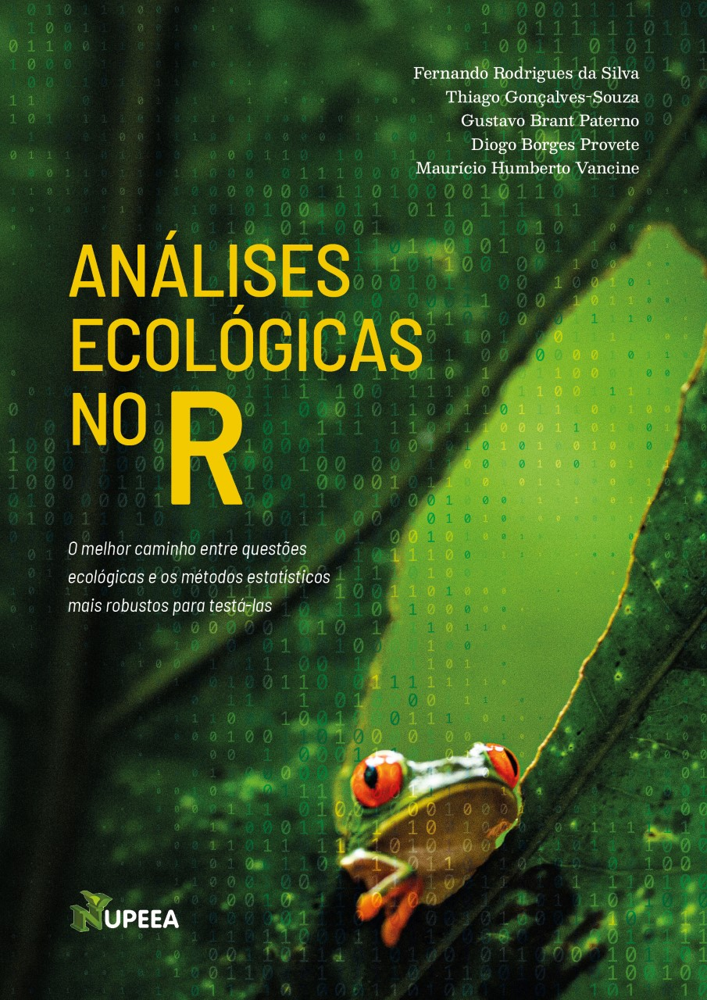
</center>
:::

::: {.column width="60%"}
-   15 capítulos: linguagem R, tidyverse, perguntas em ecologia, análises univariadas, multivariadas e geoespaciais

-   [bookdown](https://analises-ecologicas.com/)

-   [PDF](https://canal6.com.br/livreacesso/livro/analises-ecologicas-no-r/)

-   [Amazon](https://www.amazon.com.br/An%C3%A1lises-ecol%C3%B3gicas-Ferdo-Rodrigues-Silva/dp/857917564X/ref=sr_1_1?keywords=9788579175640&qid=1654379366&sr=8-1)

-   [Código Fonte](https://github.com/paternogbc/livro_aer)

-   [YouTube](https://www.youtube.com/channel/UCLSVSCnmvf2k6OoWZCnEO4w)
:::
:::::

::: footer
[Da Silva et al. (2022)](https://analises-ecologicas.com/)
:::

## Ensino de R no Brazil (2025-2026)

::: {style="font-size: 70%;"}
**Oecologia Australis - Special Issue**\
*Teaching Ecology: Challenges and Possibilities*
:::

**THE CHALLENGES AND NUANCES OF TEACHING THE R PROGRAMMING LANGUAGE TO ECOLOGISTS**

::: {style="font-size: 55%;"}
Maurício Humberto Vancine, Pavel Dodonov, Bruno Vilela, Luisa Diele-Viegas, Victor Casagrande Souza, Felipe Alvarez Silva Nunes, Ana Julia Oliveira Silva, Beatriz Milz, Cristina A. Kita, Marco A. R. Mello, Renata L. Muylaert
:::

::: {style="font-size: 70%;"}
- R como ferramenta essencial na Ecologia
- Desafios no ensino para estudantes de Biologia e Ecologia
- Importância da infraestrutura e fundamentos antes do aprendizado
- Dificuldades com conceitos abstratos e interpretação de resultados
- Impactos da COVID-19 e da IA no ensino
- Formação de profissionais com fortes habilidades analíticas
:::

::: footer
[Oecologia Australis - Teaching Ecology: Challenges and Possibilities](https://revistas.ufrj.br/index.php/oa/TeachEcology)
:::

## Consultorias {.smaller}

<br>

**2018-2019: Aquaflora/Lactec - Curitiba, PR, Brasil**

-   Rompimento da barragem de Fundão em Marina/MG

**2019-2021: PROECO Ambiental - Poços de Caldas, MG, Brasil**

-   Modelagem de Distribuição de Espécies

**2018-2025: Seleção Natural - Piracicaba, SP, Brasil**

-   Analista de dados ecológicos
-   Métricas da paisagem e dorredores ecológicos
-   Modelagem de Distribuição de Espécies

## Resumindo

::: incremental
- Aprendi muita coisa sozinho e ensinando

- Sou brasileiro e não desisto nunca...

- Saber R não me tornou um **Ecólogo**, esse conhecimento vem da nossa formação (aulas, cursos, discussões, leituras, INTERAÇÕES, etc.)

- Entretanto, saber R me tornou um **Ecólogo mais preparado**, i.e., com mais ferramentas para poder **pensar operacionalmente** nos problemas: eu sabia a **teoria** e tinha o **conhecimento prático** para aplicar soluções
:::

## Mas não foi fácil... E ainda não é...

<center>
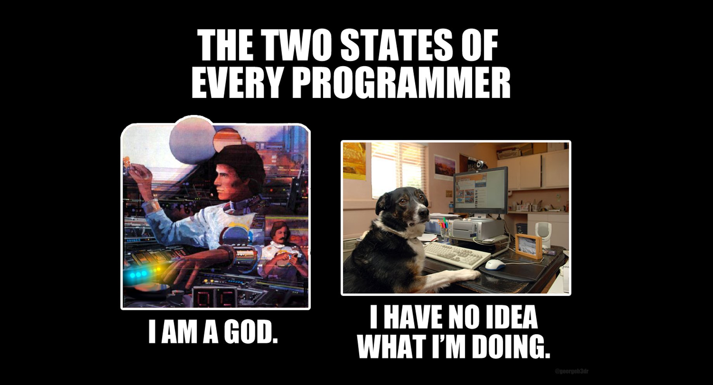
</center>

# Linguagem R

## Definição

O R é uma **linguagem de programação livre** (*open source*), direcionada à **manejo, análise e visualização de dados**, com diversas **expansões** (*pacotes*) para o uso de **dados com formatos específicos**

<center>

</center>

::: footer
[R](https://www.r-project.org/)
:::

## Histórico - Linguagem S {.smaller}

**John M. Chambers (Stanford University, CA, EUA)**

<br>

**Versões de Progração Orientada a Objetos**

- Old S (1976-1987)
- New S (1988-1997)
- S4 (1998)
- R6 (2014)

**IDE (*Integrated Development Environment*)**

-   Interface: S-PLUS (1988-2008)

{.absolute width="400" height="400" right="10" top="200"}

::: footer
[Wickham (2013)](http://vita.had.co.nz/papers/r-s.pdf)
:::

## Histórico - Linguagem R {.smaller}

**Robert Gentleman e Ross Ihaka (Auckland University, NZ)**

<br>

**Versões**

-   Desenvolvimento (1997-2000)
-   Versão 1 (2000-2004)
-   Versão 2 (2004-2013)
-   Versão 3 (2013-2020)
-   Versão 4 (2020-atual)

**IDE (*Integrated Development Environment*)**

-   Interface: RStudio (2011-atual)
-   Atualmente: **R Core Team**

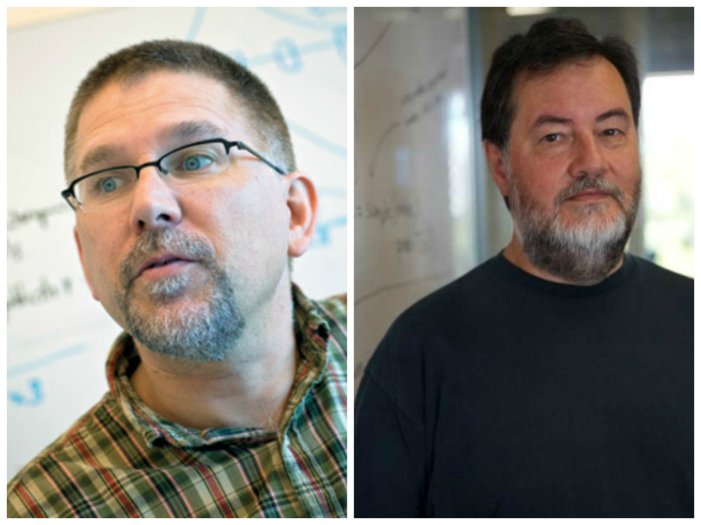{.absolute width="550" height="400" right="-50" top="200"}

::: footer
[Ihaka & Gentleman (1996)](https://doi.org/10.2307/1390807),
[Wickham (2013)](http://vita.had.co.nz/papers/r-s.pdf)
:::

## Histórico - Linguagem R {.smaller}

::::::: columns
:::: {.column width="50%"}
::: nonincremental
<center>
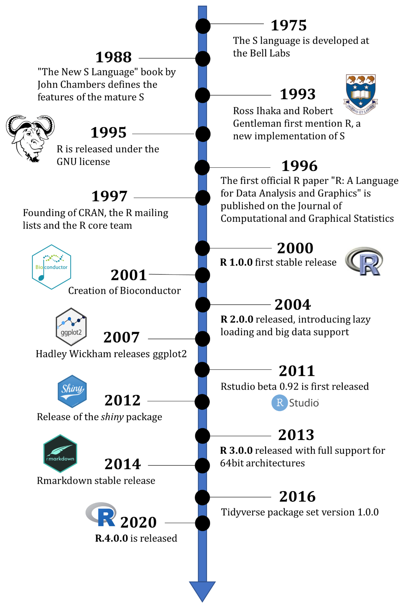
</center>
:::
::::

:::: {.column width="50%"}
::: nonincremental
<center>
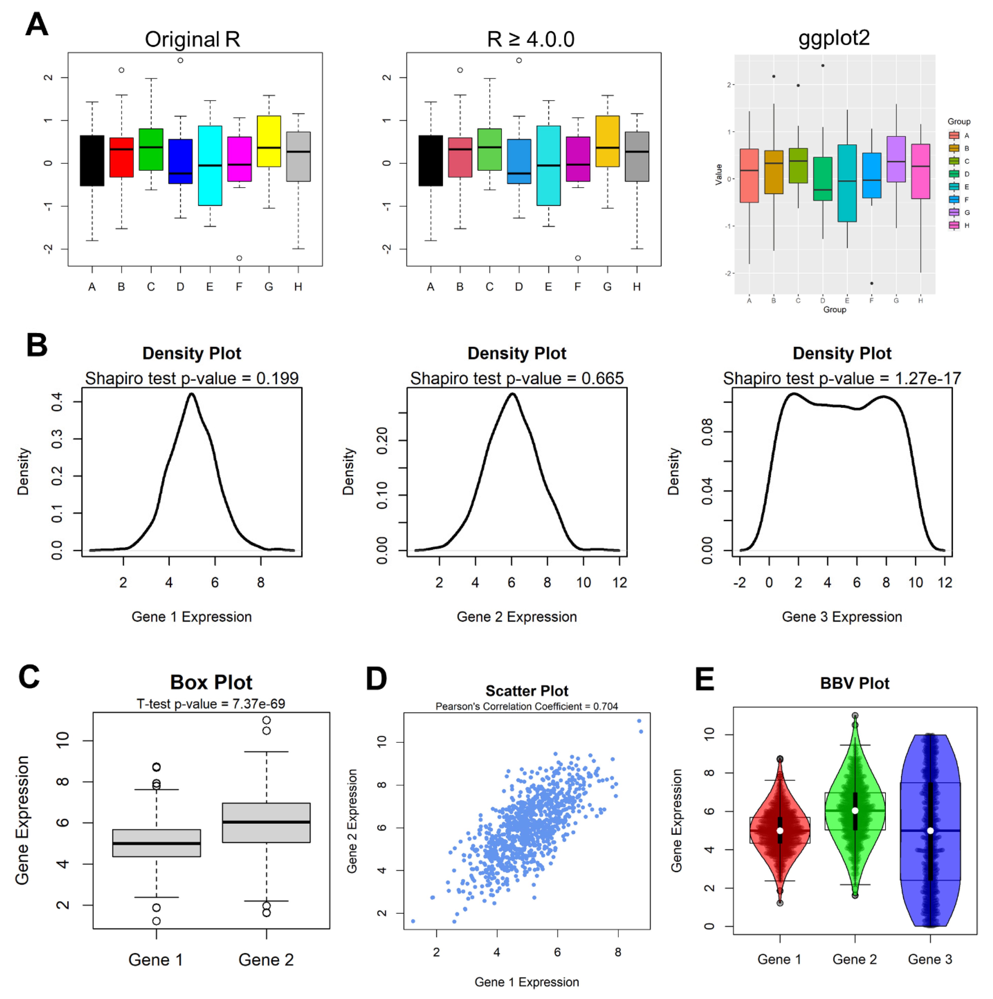
</center>
:::
::::
:::::::

::: footer
[Giorgi et al. (2022)](https://doi.org/10.3390/life12050648)
:::

## Aplicações {.smaller}

**Manejo, visualização e análise de dados**

-   Estatísticas univariadas e multivariadas
-   Análises de dados ecológicos
-   Análise de dados espaciais, temporais e sonoros
-   Análise de dados funcionais, genéticos e filogenéticos
-   Análise de dados geoespaciais e sensoriamento remoto
-   Visualização de todos os tipos de dados anteriores

**R Markdown e quarto**

-   Textos em HTML, PDF, Word, ODT, Markdown
-   Slides, Websites, Blogs, Livros e Artigos
-   Shiny

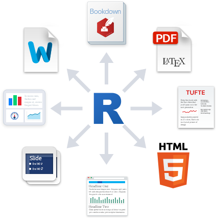{.absolute width="400" height="400" right="-100" top="150"} {.absolute width="400" height="100" right="-100" top="570"}

::: footer
[R Markdown](https://rmarkdown.rstudio.com/), [shiny](https://shiny.rstudio.com/), [quarto](https://quarto.org/)
:::

# RStudio

## IDE

Ambiente de Desenvolvimento Integrado (*Integrated Development Environment*)

<br><br>

<center>

</center>

::: footer
[RStudio](https://posit.co/downloads/)
:::

## IDE

Ambiente de Desenvolvimento Integrado (*Integrated Development Environment*)

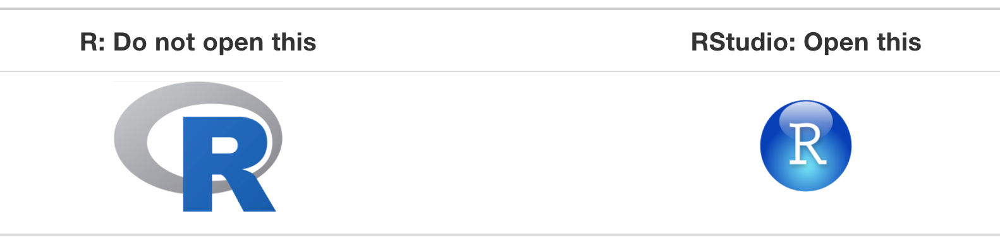{.absolute width="700" height="180" right="180" top="200"} 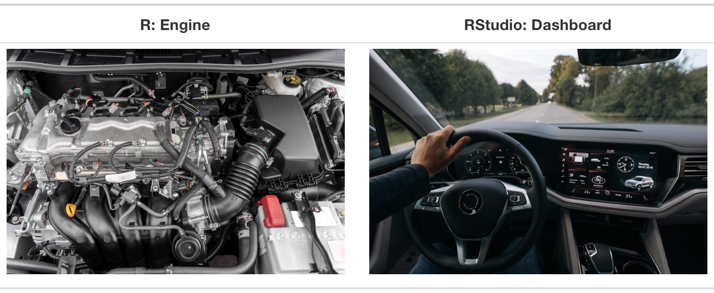{.absolute width="700" height="280" right="180" top="370"}

::: footer
[Ismay & Kim (2020)](https://posit.co/downloads/)
:::

## Posit

Mudanças na empresa RStudio...

<center>
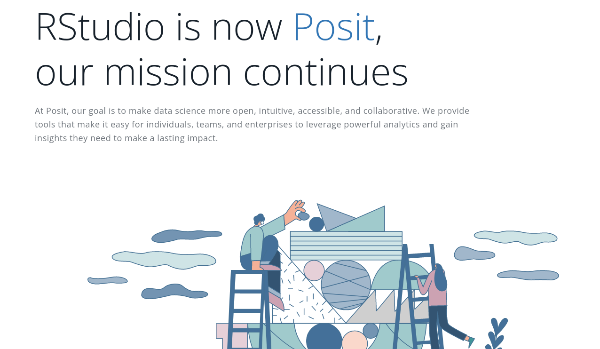
</center>

::: footer
[posit](https://posit.co/)
:::

## Positron

- IDE multiplataforma voltada para R, Python, Quarto
- Baseado no [Visual Studio Code](https://code.visualstudio.com)

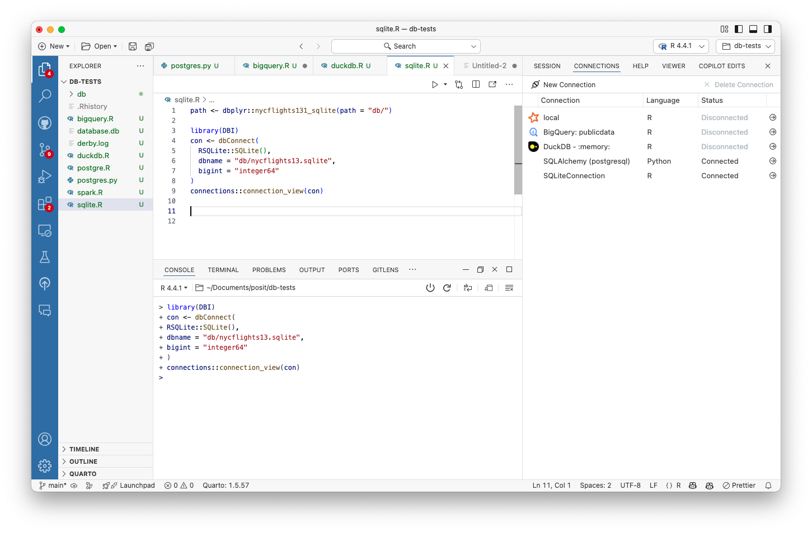{.absolute width=70% right=150 top=220}
{.absolute width=25% right=190 top=600}

::: footer
[Positron](https://posit.co/products/ide/positron/)
:::

# Voltando para o RStudio

## Interface

<center>
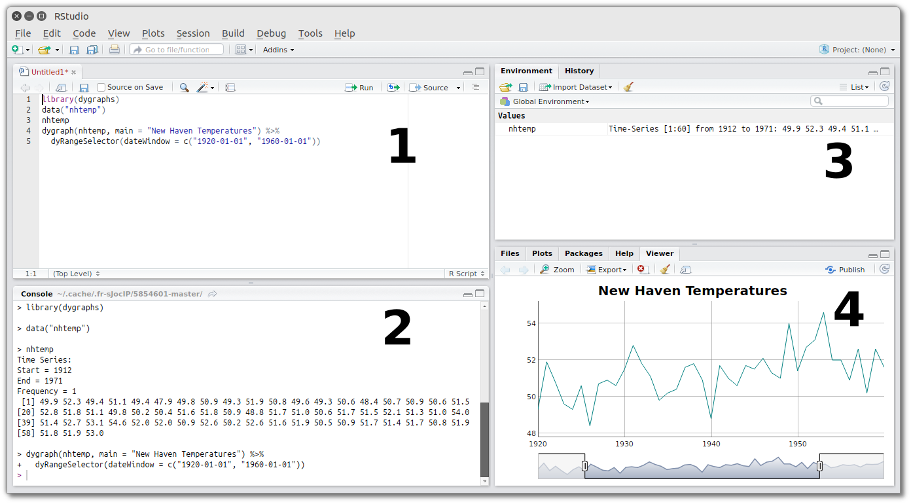
</center>

::: footer
[RStudio](https://www.rstudio.com/)
:::

## Janelas e abas {.smaller}

<br>

**1. Editor/Script**: é onde escrevemos nossos códigos em R ou R Markdown\
**2. Console**: é onde os códigos são rodados e vemos as saídas\
**3. Environment**: painel com todos os objetos criados na sessão\
**3. History**: painel com o histórico dos códigos rodados\
**3. Connection**: painel para conectar banco de dados\
**3. Git**: painel do controle de versão\
**3. Tutorial**: painel de tutoriais\
**4. Files**: painel que mostra os arquivos no diretório de trabalho\
**4. Plots**: painel onde os gráficos são apresentados\
**4. Packages**: painel que lista os pacotes\
**4. Help**: painel onde a documentação das funções é exibida\
**4. Viewer**: painel de visualização

{.absolute width="500" height="250" right="-170" top="420"}

::: footer
[RStudio](https://www.rstudio.com/)
:::

## Atalhos {.smaller}

<br>

**f1**: abre o painel de *Help*\
**ctrl + enter**: roda a linha selecionada no script\
**ctrl + shift + N**: abre um novo script\
**ctrl + S**: salva um script\
**ctrl + Z**: desfaz uma operação\
**ctrl + shift + Z**: refaz uma operação\
**alt + -**: insere um sinal de atribuição (\<-)\
**ctrl + shift + M**: insere um operador pipe (%\>%)\
**ctrl + shift + C**: comenta uma linha no script - insere um (#)\
**ctrl + shift + R**: insere uma sessão (# ----------------------)\
**ctrl + shift + H**: abre uma janela para selecionar o diretório de trabalho\
**ctrl + shift + f10**: reinicia o console\
**ctrl + L**: limpa os códigos do console\
**alt + shift + K**: abre uma janela com todos os atalhos disponíveis

::: footer
[RStudio](https://www.rstudio.com/)
:::

## Projeto R (.Rproj)

-   Facilita o trabalho em múltiplos ambientes
-   Cada projeto possui seu diretório, documentos e workspace
-   Permite controle de versão (git e GitHub)

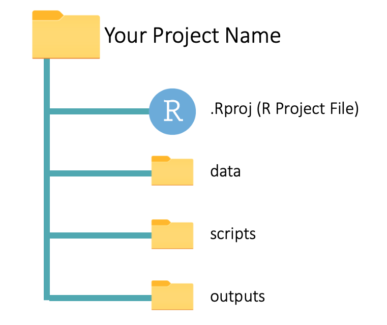{.absolute width="450" height="400" right="500" top="300"}
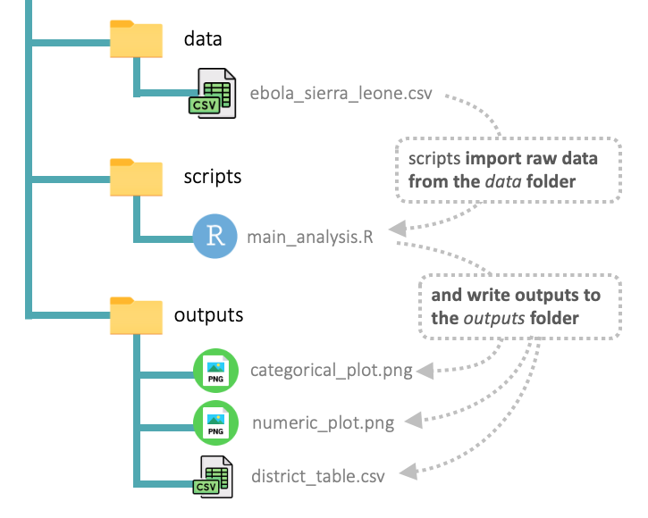{.absolute width="450" height="400" right="0" top="300"}

::: footer
[Foundations of data analysis with R](https://thegraphcourses.org/courses/r-foundations-beta/topics/rstudio-projects/)
:::

# 

<center>
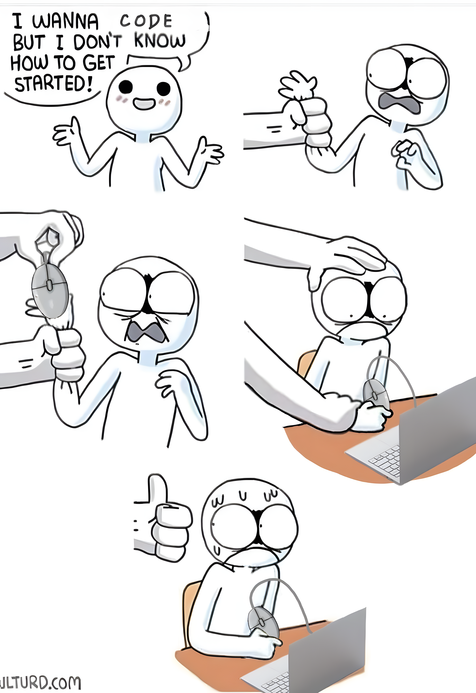
</center>

## Projeto R (.Rproj)

Abram o RStudio e criem um projeto dentro de "course-intror"

<center>
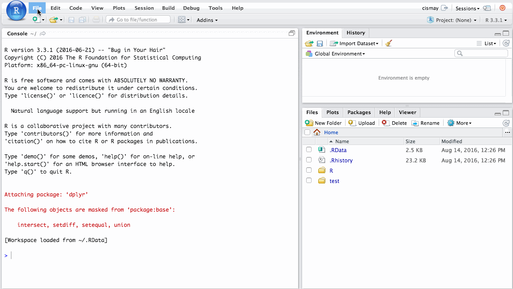
</center>

# Console

## Console

O console é onde a linguagem R instalada é carregada para executar os códigos

<center>
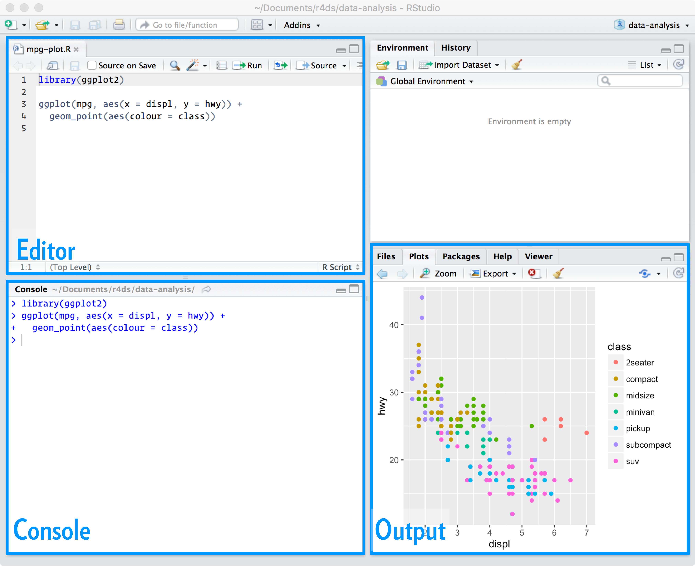
</center>

::: footer
[RStudio](https://www.rstudio.com/)
:::

## Console

-   Na janela do console aparece o símbolo `>`, seguido de uma barra vertical `|` que fica piscando (cursor), onde digitamos ou enviamos nossos códigos do script

-   Vamos digitar `10 + 2` e apertar a tecla `Enter` para que essa operação seja executada

-   O resultado retorna o valor `12`, precedido do valor um entre colchetes `[1]`

```{r}
10 + 2
```

## Console

-   Os colchetes `[]` demonstram a posição do elemento numa sequência de valores

-   Vamos criar uma sequência usando o operador `:` para demonstrar isso

-   O número que aparecer nos colchetes vai depender da largura das janelas

```{r}
1:42
```

# Script

## Script

Onde os códigos são escritos e salvos no formato .R

-   Atalho: `ctrl + shift + N`

<center>
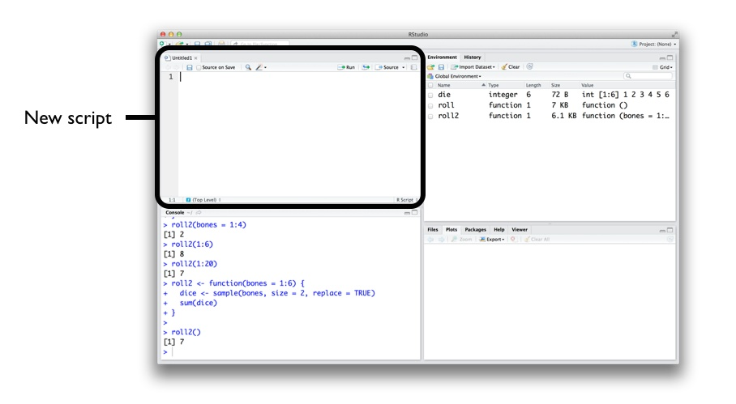
</center>

## Script

-   Os códigos devem ser digitados preferencialmente no script

-   Para executar um código, deixem o cursor em qualquer lugar da linha

-   Atalho: `ctrl + enter`

```{r}
1
```

<br>

```{r}
1 + 2
```

## Script

**Salvar um script**

-   Atalho: `ctrl + S`

<center>

</center>

## Script

**Salvar um script**

-   Diretório: `course-intror/02_scripts/`

00_plano_ensino\
01_slides\
**02_scripts**\
03_dados\
04_projetos

-   Nome: `01_script_intror.R`

## Script

**Comentários (#)**

-   Comentários não são lidos pelo R e descrevem informações em nosso script

-   São representados pelo `#` (hash) ou `#'` (hash-linha)

```{r}
# comentarios
# o r nao le o codigo depois do # (hash)

42 # essas palavras nao sao executadas, apenas o 42
```

## Script

**Comentários (#)**

-   Sempre comece um script com um cabeçalho

-   Ajuda a lembrar o que o script faz e quando foi escrito

```{r}
#' ----
#' titulo: introR: introdução à linguagem R
#' autor: seu nome (escreva seu nome)
#' data: 14-10-2024
#' ----
```

## Script

**Seções nos comentários (---)**

- Ajudam a separar e organizar o script
- Dois tipos:

1. Longos (`Ctrl + Shfit + R`)
2. Curtos (ao menos 4 `-`)
```{r}
# longos -----------------------------------------------------------------

## curtos ----
```

Acesso: Outline (`Ctrl + Shfit + O`)

# Operadores

## Operadores

**Operadores aritméticos (Números)**

| Operador |      Descrição       |   Uso   |
|:--------:|:--------------------:|:-------:|
|    \+    |        Adição        |  a + b  |
|    --    |      Subtração       |  a - b  |
|    \*    |    Multiplicação     | a \* b  |
|    /     |       Divisão        |  a / b  |
|    %%    |   Resto da divisão   | a %% b  |
|   %/%    | Quociente da divisão | a %/% b |
|    \^    |     Potenciação      |  a\^b   |

## Operadores

**Operadores relacionais (TRUE\|FALSE)**

| Operador |       Descrição       |   Uso    |
|:--------:|:---------------------:|:--------:|
|    \<    |         Menor         |  a \< b  |
|    \>    |         Maior         |  a \> b  |
|    ==    |         Igual         |  a == b  |
|   \<=    |    Menor ou igual     | a \<= b  |
|   \>=    |    Maior ou igual     | a \> = b |
|    !=    | Não igual (diferente) |   a!=b   |

## Operadores

**Ordem das operações aritméticas**

<br>

`()` \> `^` \> `*` ou `/` \> `+` ou `-`

<br>

```{r}
# sem especificar - segue a ordem das operações
1 * 2 + 2 / 2 ^ 2
```

<br>

```{r}
# especificando - segue a ordem dos parênteses
((1 * 2) + (2 / 2)) ^ 2
```

# Objetos

## Objetos

Palavras que atribuímos (guardamos) dados possibilitando sua manejo

-   Atribuição (\<-)

-   palavra \<- dados

-   Atalho: `alt + -`

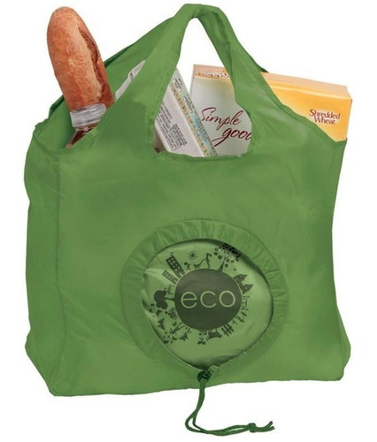{.absolute width="380" height="480" right="50" top="200"}

## Objetos

Vamos atribuir o valor `10` à palavra `eco`

```{r}
# atribuicao - simbolo (<-)
eco <- 10 
```

# 

<center>
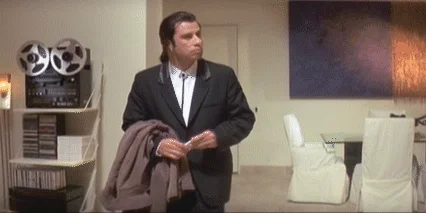
</center>

## Objetos

-   Sempre confira a atribuição

-   Dica: chame o objeto novamente

```{r}
# atribuicao - simbolo (<-)
eco <- 10 
eco
```

## Objetos

**Seja criativo**

O R sobrescreve os valores dos objetos com o mesmo nome

```{r}
# eco vale 10
eco <- 10 
eco
```

<br>

```{r}
# agora eco vale 2
eco <- 2 
eco
```

## Objetos {.smaller}

**Seja criativo, mas nem tanto...**

O R tem limitações ao nomear objetos!

1.  Começar por letras (a-z ou A-Z) ou pontos (.)

2.  Conter letras (a-z ou A-Z), números (0-9), underscores (\_) ou pontos (.)

3.  *Case-sensitive*, i.e., ele difere letras maiúsculas de minúsculas

4.  Evitar utilizar letras maiúsculas, acentos ou cedilha (ç)

5.  Não podem ser iguais a nomes especiais: `break, else, FALSE, for, function, if, Inf, NA, NaN, next, repeat, return, TRUE, while`

```{r error=TRUE}
for <- 1
```

## Objetos

**Ambiente (*Environment*)**

Os objetos podem ser visualizados no painel *Environment*

<center>

</center>

## Objetos

Podemos utilizar objetos para fazer operações

```{r}
# definir dois objetos
eco1 <- 10
eco2 <- 2
```

<br>

```{r}
# operacoes com objetos
eco1 + eco2 # adicao
eco1 - eco2 # subtracao
eco1 * eco2 # multiplicacao
eco1 / eco2 # divisao
```

## Objetos

Podemos utilizar objetos para atribuir resultados de operações

```{r}
# operacoes com objetos e atribuicao
adi <- eco1 + eco2 # adicao
adi

sub <- eco1 - eco2 # subtracao
sub

mul <- eco1 * eco2 # multiplicacao
mul

div <- eco1 / eco2 # divisao
div
```

# Funções

## Funções

Códigos que realizam operações em argumentos

-   Estrutura de uma função:

`nome_da_funcao(argumento1, argumento2)`

::: {style="font-size: 70%;"}
1.  **Nome da função**: remete ao que ela faz (inglês)
2.  **Parênteses**: limitam a função
3.  **Argumentos**: onde a função atuará
4.  **Vírgulas**: separam os argumentos
:::

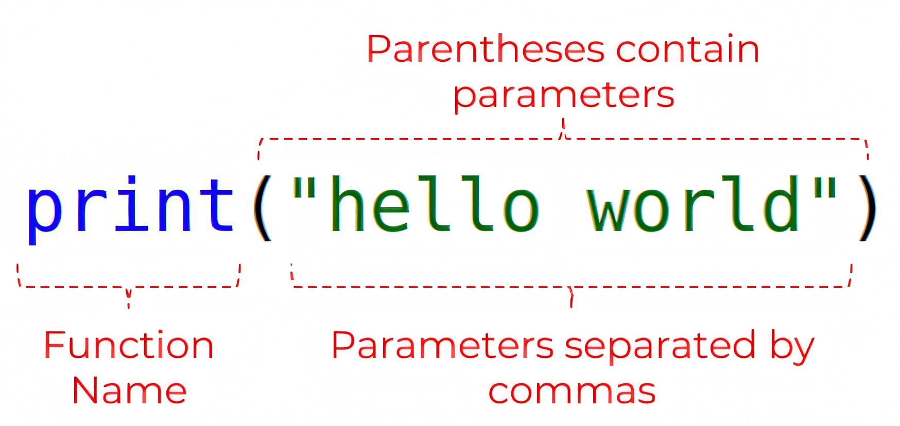{.absolute width="600" height="300" right="-100" top="350"}

## Funções

**Exemplos**

```{r}
# soma
sum(10, 2)

# soma de objetos
sum(eco1, eco2)

# soma de objetos atribuidos a objetos
eco_sum <- sum(eco1, eco2)
eco_sum
```

## Funções

**Argumentos**

Os argumentos podem ser de dois tipos:

1.  **Objetos ou valores**: dados onde a função irá atuar

2.  **Parâmetros**: mudam o comportamento da função (texto = TRUE\|FALSE ou "texto")

```{r}
sum(1, 2, 3, NA)
sum(1, 2, 3, NA, na.rm = TRUE)
```

## Funções

**Argumentos como valores**

```{r}
# funcoes - argumentos como valores
sum(10, 2)
prod(10, 2)
```

**Argumentos como objetos**

```{r}
# funcoes - argumentos como objetos
sum(eco1, eco2)
prod(eco1, eco2)
```

## Funções

**Argumentos como parâmetros**

```{r}
# repeticao - vezes
rep(x = 1:5, times = 5)
```

<br>

```{r}
# repeticao - cada
rep(x = 1:5, each = 5)
```

## Funções

**Atribuição de resultados a objetos**

```{r}
# atribuicao dos resultados
rep_times <- rep(x = 1:5, times = 5)
rep_times
```

<br>

```{r}
rep_each <- rep(x = 1:5, each = 5)
rep_each
```

## Funções

**Atribuição, função e linha temporal**

Criar dois objetos

```{r}
# criar dois objetos
foo <- 2
bar <- 3
```

Somar esses objetos e atribuição

```{r}
# somar e atribuir
su <- sum(foo, bar)
su
```

Raiz quadrada e atribuição

```{r}
# raiz e atribuir
sq <- sqrt(su)
sq
```

## Funções

**Atribuição, função e linha temporal**

1.  Atribuição de dados a objetos

2.  Funções que operam e mudam esses dados

3.  Nova atribuição desses resultados a novos objetos

```{r}
# criar dois objetos
foo <- 2
bar <- 3

# somar e atribuir
su <- sum(foo, bar)

# raiz e atribuir
sq <- sqrt(su)
```

# Ajuda

## Ajuda {.smaller}

Descreve as informações de uma função

```{r eval=FALSE}
# descreve as informacoes de uma funcao
help("mean") # arquivo .html
?mean
```

::::: columns
::: {.column width="50%"}
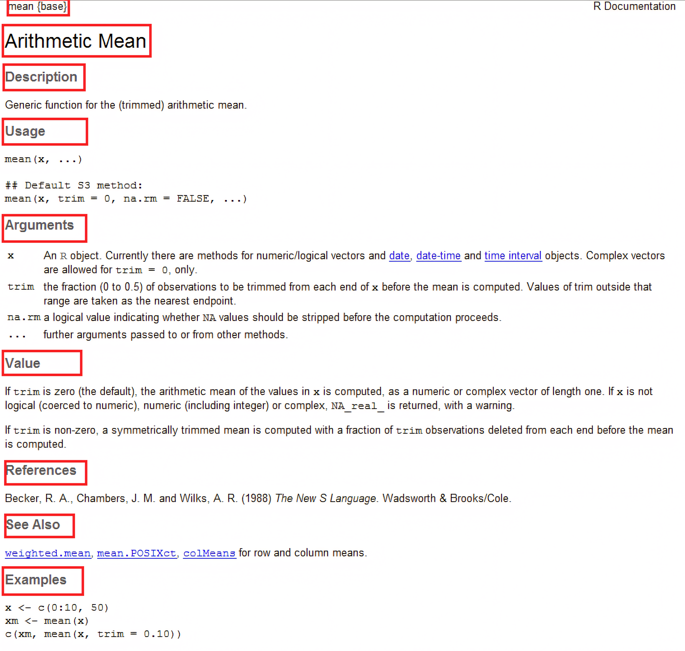{.absolute width="450" height="450" right="600" top="220"}
:::

::: {.column width="50%"}
<br> **Description**: descrição da função\
**Usage**: uso da função e argumentos\
**Arguments**: argumentos e suas especificações\
**Details**: detalhes da função\
**Value**: interpretar a saída (*output*)\
**Note**: notas sobre a função\
**Authors**: autores da função\
**References**: referências bibliográficas da função\
**See also**: funções relacionadas\
**Examples**: exemplos do uso da função
:::
:::::

# Ambiente

## Ambiente

Local onde os objetos são armazenados

**Tamanho dos objetos**

```{r}
# tamanho de um objeto
object.size("eco")
```

**Listar os objetos criados**

```{r}
# listar objetos
ls()
objects()
```

## Ambiente

Local onde os objetos são armazenados

**Remover objetos criados**

```{r}
# remover um objeto
rm(bar)
```

**Remover todos os objetos criados**

```{r}
# remover todos os objetos
rm(list = ls())
```

## Ambiente

Toda a vez que fechamos o R, os objetos criados são apagados

<br>

**Salvar todos os objetos criados (.RData)**

> Session -\> Save Workspace As... -\> meus_objetos.RData

```{r eval=FALSE}
# exportar objetos
save.image("todos_meus_objetos.RData")
```

**Carregar os objetos criados e salvos**

> Session -\> Load Workspace... -\> meus_objetos.RData

```{r eval=FALSE}
# importar objetos
load("todos_meus_objetos.RData")
```

# Pacotes

## Pacotes

Conjunto de funções extras para executar tarefas específicas

<center>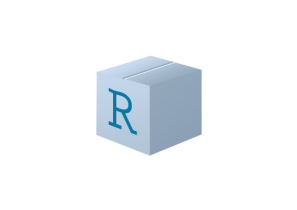</center>

## Pacotes

Duas fontes

-   CRAN (*Comprehensive R Archive Network*)
-   GitHub (Repositório de códigos)

```{r eval=FALSE}
# numero de pacotes no cran
nrow(available.packages())
```

```{r}
#| echo: false
#| message: false
#| warning: false
#| fig-align: "center"

library(rvest)
library(stringr)
library(lubridate)
library(tidyverse)

cran_link <- function(...) {
  file.path("https://cran.rstudio.com/src/contrib", ...)
}

pkgs <- read_html(cran_link()) %>% 
  html_text() %>% 
  tibble(text = unlist(str_split(., pattern = "\n"))) %>% 
  select(text) %>% 
  slice(-(1:2)) %>% 
  as.matrix() %>% 
  str_trim() %>% 
  as_tibble() %>% 
  filter(str_detect(string = value, pattern = ".tar.gz")) %>% 
  mutate(name = str_split(string = value, pattern = ".tar.gz", simplify = TRUE)[, 1],
         date = str_trim(str_split(string = value, pattern = ".tar.gz", simplify = TRUE)[, 2])) %>% 
  mutate(date = as_date(str_split(string = date, pattern = " ", simplify = TRUE)[, 1])) %>% 
  select(name, date)

pkgs_data <- pkgs %>%
  group_by(date = floor_date(date, unit = "month")) %>%
  summarise(NewPackages = n()) %>%
  ungroup() %>%
  mutate(TotalPackages = cumsum(NewPackages))

ggplot(data = pkgs_data, aes(date, TotalPackages)) +
  geom_line(size = 2, color = "midnightblue") +
  geom_hline(
    yintercept = pkgs_data[nrow(pkgs_data), ]$TotalPackages,
    lty = 2
  ) +
  annotate(
    "text",
    x = lubridate::today() - 300,
    y = pkgs_data[nrow(pkgs_data), ]$TotalPackages + 1500,
    label = pkgs_data[nrow(pkgs_data), ]$TotalPackages,
    size = 10
  ) +
  scale_x_date(
    date_breaks = "1 year",
    date_labels = "%Y"
  ) +
  labs(
    x = NULL,
    y = "Número de pacotes disponíveis",
    title = "Quantos pacotes estão disponíveis no CRAN?",
    subtitle = "Todos os pacotes já criados"
  ) +
  theme_minimal() +
  theme(
    title = element_text(size = 25),
    axis.title = element_text(size = 20),
    axis.text = element_text(size = 15),
    axis.text.x = element_text(angle = 90, vjust = 0.5, hjust = 1)
  )
```

::: footer
[CRAN](https://cran.r-project.org/), [Scraping CRAN with rvest](https://www.r-bloggers.com/2017/03/scraping-cran-with-rvest/)
:::

## Pacotes {.smaller}

**Instalação de pacotes**

1.  Download do pacote para o computador (como instalar um software/APP)
2.  Precisa estar conectado à internet
3.  O nome do pacote precisa estar entre aspas
4.  Função (CRAN): `install.packages("pacote")`

**Instalar o pacote vegan**

```{r eval=FALSE}
# instalar pacotes
install.packages("vegan")
```

**Verificar pacotes instalados**

```{r eval=FALSE}
# verificar pacotes instalados
library()
```

## Pacotes {.smaller}

**Carregamento de pacotes**

1.  Carregar o pacote para o R (como abrir software/APP)
2.  Carrega-se toda vez que se abre o R
3.  Não precisa estar conectado à internet
4.  O nome do pacote não precisa estar entre aspas
5.  Funções: `library(pacote)` ou `require(pacote)`

**Carregar o pacote vegan**

```{r}
# carregar pacotes
library(vegan)
```

**Verificar pacotes carregados**

```{r}
# verificar pacotes carregados
search()
```

## Pacotes {.smaller}

**Instalação de pacotes em desenvolvimento - GitHub**

1.  Instalar pacote `remotes` ou `devtools`

```{r eval=FALSE}
# instalar pacote remotes
install.packages("remotes")

# carregar pacote remotes
library(remotes)
```

2.  Instalar usando a função `install_github()`
3.  Atentar para usar essa forma **usuário/repositório**

```{r eval=FALSE}
# instalar pacote do github
install_github("vegandevs/vegan")

# carregar pacote do github
library(vegan)
```

::: footer
[vegandevs/vegan](https://github.com/vegandevs/vegan)
:::

## Pacotes

**Atualização de pacotes**

-   São atualizados com certa frequência e não se atualizam sozinhos
-   A instalação de um pacote pode depender da versão mais atual de outros pacotes
-   Geralmente é uma função que pode demorar para rodar

```{r eval=FALSE}
# atualizacao dos pacotes instalados 
update.packages(ask = FALSE, checkBuilt = TRUE) 
```

# Citações

## Citações

Citação da linguagem R

```{r}
# citacao do R
citation()
```

::: footer
[LaTeX](https://www.latex-project.org/), [BibTeX](http://www.bibtex.org/), [Zotero](https://www.zotero.org/)
:::

## Citações

Citação dos pacotes

```{r}
# citacao dos pacotes
citation("vegan")
```

# Principais erros

# Se seu script rodou sem erros, tem algo errado...

# 

<center>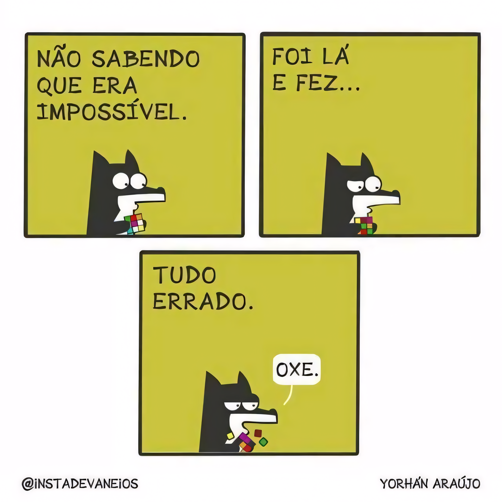</center>

# 

<center>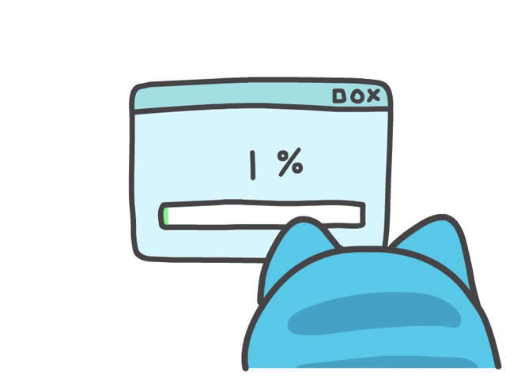</center>

# 

<center>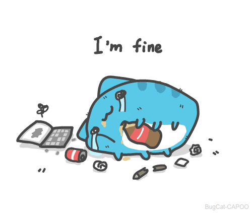</center>

# 

<center>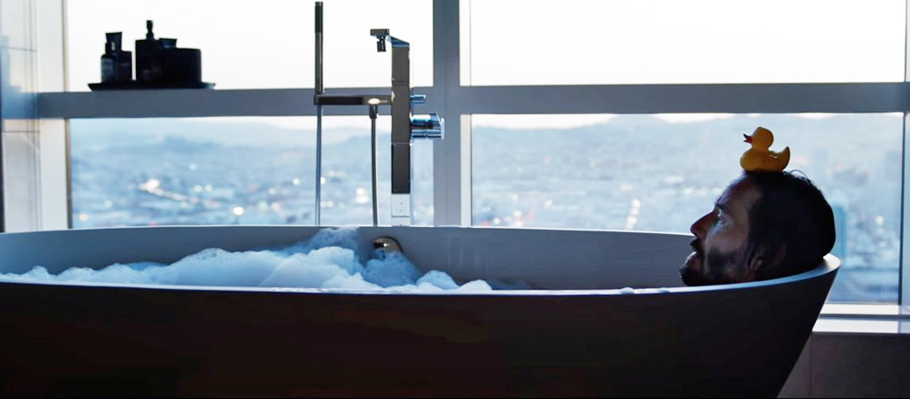</center>

::: footer
[Rubber duck debugging](https://en.wikipedia.org/wiki/Rubber_duck_debugging), [Matrix](https://www.warnerbros.com/movies/matrix)
:::

# 

Help me help you: um bestiário para entender erros e pedir ajuda no R

<center>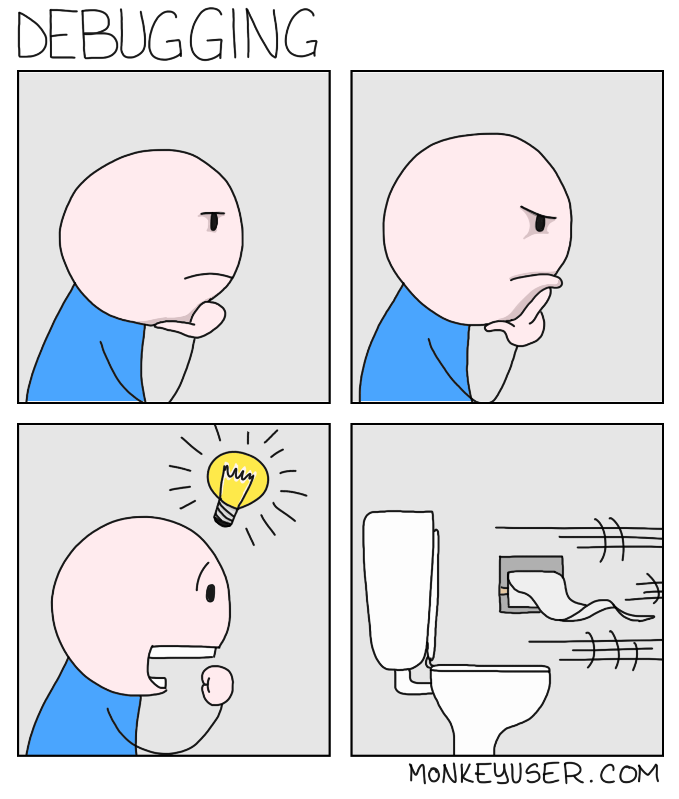</center>

::: footer
[Help me help you: um bestiário para entender erros e pedir ajuda no R](https://anotherecoblog.wordpress.com/2020/08/26/help-me-help-you-um-bestiario-para-entender-erros-e-pedir-ajuda-no-r/)
:::

## Principais erros

**1. Esquecer de completar um código (+)**

Parênteses

```{r error=TRUE}
sum(1, 2
    ```
    
    Aspas
    
    ```{r error=TRUE}
    "string
```

## Principais erros

**2. Esquecer da vírgula**

```{r error=TRUE}
sum(1 2)
```

<br>

**3. Chamar um objeto errado**

```{r error=TRUE}
obj <- 10
OBJ
```

## Principais erros

**4. Esquecer de carregar um pacote**

```{r echo=FALSE}
detach("package:vegan", unload = TRUE)
```

```{r error=TRUE}
# carregar dados
data(dune)

# funcao do pacote vegan
decostand(dune, "hell")
```

## Principais erros

**4. Esquecer de carregar um pacote**

```{r}
# carregar o pacote
library(vegan)

## carregar dados
data(dune)

## funcao do pacote vegan
decostand(dune, "hell")
```

## Principais erros

**5. Usar o nome da função de forma errônea**

```{r error=TRUE}
colsums(dune)
```

<br>

```{r error=TRUE}
colSums(dune)
```

## Principais erros

**Cases**

<center>
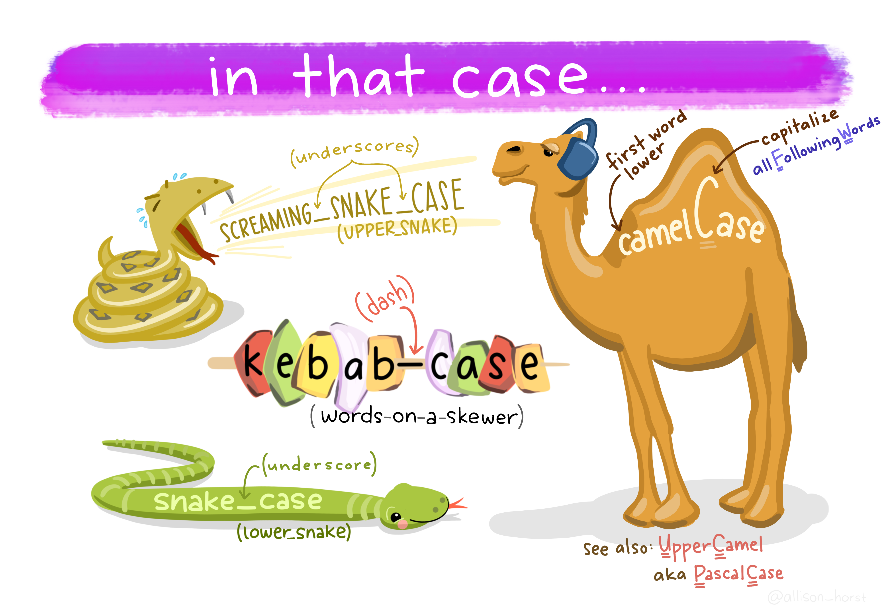
</center>

::: footer
Artwork by [@allison_horst](https://x.com/allison_horst)
:::

# Dúvidas?

## Script

Abram o script para seguir a aula

<br><br><br><br>

`01_script.R`

::: footer
[course-intror - scripts](https://github.com/course-intror/scripts)
:::

# Atributos de objetos

## Modo dos objetos (*mode*)

A natureza dos elementos definirá os modos dos objetos

::::: columns
::: {.column width="50%"}
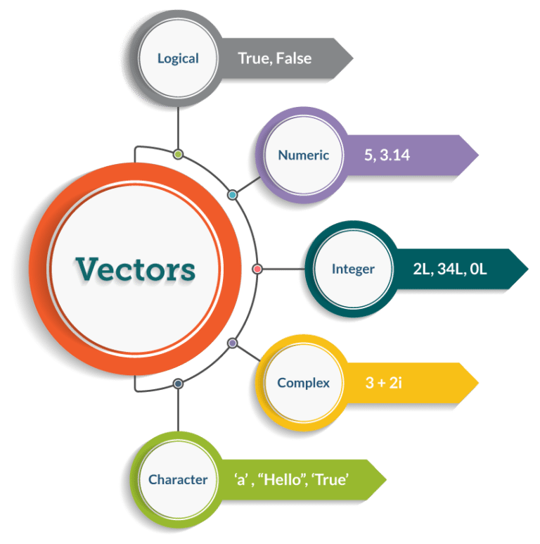
:::

::: {.column width="50%"}
```{r}
logical <- TRUE
logical

numeric <- 3.14
numeric

integer <- 2L
integer

complex <- 3 + 2i
complex

character <- "a"
character
```
:::
:::::

## Modo dos objetos (*mode*)

Verificar e mudar a natureza dos modos dos objetos

::::: columns
::: {.column width="50%"}

:::

::: {.column width="50%"}
```{r eval=FALSE}
## verificar o modo dos objetos
is.logical()
is.numeric()
is.integer()
is.complex()
is.character()

## conversoes entre modos
as.logical()
as.numeric()
as.integer()
as.complex()
as.character()
```
:::
:::::

## Estrutura dos objetos (*class*)

Organização dos elementos dos objetos

<center>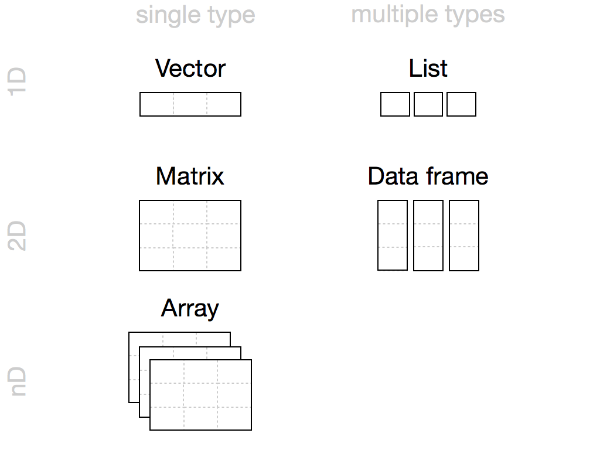</center>

## Estrutura dos objetos (*class*) {.smaller}

**Vector**

Sequência de valores que representam uma variável contínua ou descrição textual

::::: columns
::: {.column width="50%"}
<br><br> 
:::

::: {.column width="50%"}
```{r}
# concatenar
c(1, 2, 3)
c("amostra1", "amostra2", "amostra3")

# sequencia
seq(1, 10, 2)

# repetir
rep(c(23, 42), times = 2)
rep(c(23, 42), each = 2)

# combinar
paste("amostra", 1:3)

# amostrar
sample(1:60, 6)
```
:::
:::::

## Estrutura dos objetos (*class*) {.smaller}

**Factor**

Sequência de valores que representam uma variável categórica (níveis)

::::: columns
::: {.column width="50%"}
<br><br> 
:::

::: {.column width="50%"}
```{r}
# factor nominal
ftc_nom <- factor(
  x = sample(c("f", "p"), size = 20, rep = TRUE),
  levels = c("f", "p"))
ftc_nom
levels(ftc_nom)

# factor ordinal
ftc_ord <- factor(
  x = sample(c("b", "a"), size = 20, rep = TRUE),
  levels = c("b", "a"), ordered = TRUE)
ftc_ord
levels(ftc_ord)
```
:::
:::::

## Estrutura dos objetos (*class*) {.smaller}

**Matrix**

Representa os dados no formato de tabela, com linhas (locais) e colunas (variáveis)

::::: columns
::: {.column width="50%"}
<br><br> 
:::

::: {.column width="50%"}
```{r}
# dispor uma sequencia
ve <- 1:9
ma_col <- matrix(data = ve, nrow = 3, 
                 ncol = 3, byrow = FALSE)
ma_col

# combinar vetores
vec_1 <- c(1, 2, 3)
vec_2 <- c(4, 5, 6)

ma_rbind <- rbind(vec_1, vec_2)
ma_rbind

ma_cbind <- cbind(vec_1, vec_2)
ma_cbind
```
:::
:::::

## Estrutura dos objetos (*class*) {.smaller}

**Array**

Combinação de tabelas, com linhas (locais), colunas (variáveis) e dimensões (tempo)

::::: columns
::: {.column width="50%"}
<br><br> 
:::

::: {.column width="50%"}
```{r}
# dispor uma sequencia
ve <- sample(c(0, 1), 27, rep = TRUE)
ar <- array(data = ve, dim = c(3, 3, 3))
ar
```
:::
:::::

## Estrutura dos objetos (*class*) {.smaller}

**List**

Tipo especial de vetor que aceita objetos como elementos

::::: columns
::: {.column width="50%"}
<br><br> 
:::

::: {.column width="50%"}
```{r}
# concatenar objetos
li <- list(ve, # vector
           ma_rbind, # matrix
           ma_cbind) # outra matrix
li
```
:::
:::::

## Estrutura dos objetos (*class*) {.smaller}

**Data frame**

Representa os dados no formato de tabela, com linhas e colunas, mas misturando modos

::::: columns
::: {.column width="50%"}
<br><br> 
:::

::: {.column width="50%"}
```{r}
# combinando vetores horizontalmente
sp <- c("sp1", "sp2", "sp3")
ab <- c(12, 8, 9)
ha <- c("flo", "cer", "past")

df <- data.frame(sp, ab, ha)
df
```

```{r}
# combinando vetores horizontalmente com nomes
df <- data.frame(
  especies = paste0("sp", 1:3), 
  abundancia = sample(5:10, 3), 
  vegetacao = c("flo", "cer", "past")
)
df
```
:::
:::::

# Dúvidas?

## Muito obrigado!

::::: columns
::: {.column width="50%"}
Agradecimentos:

- [Prof. Tadeu Siqueira](https://tsiqueiralab.weebly.com/)
- [Prof. Miltinho](https://leec.eco.br/)

{.absolute width=40% right=650 top=450}
:::

::: {.column width="50%"}
Contato:

<center>
[mauricio.vancine\@gmail.com]() [mauriciovancine.github.io](mauriciovancine.github.io)
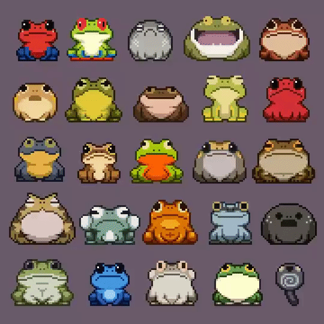
</center>
:::
:::::

::: footer
Slides por [Maurício Vancine](https://mauriciovancine.github.io/), feitos com [Quarto](https://quarto.org/). Código disponível no [GitHub](https://github.com/mauriciovancine/workshop-r-introduction/blob/master/01_slides/slides.qmd).
:::